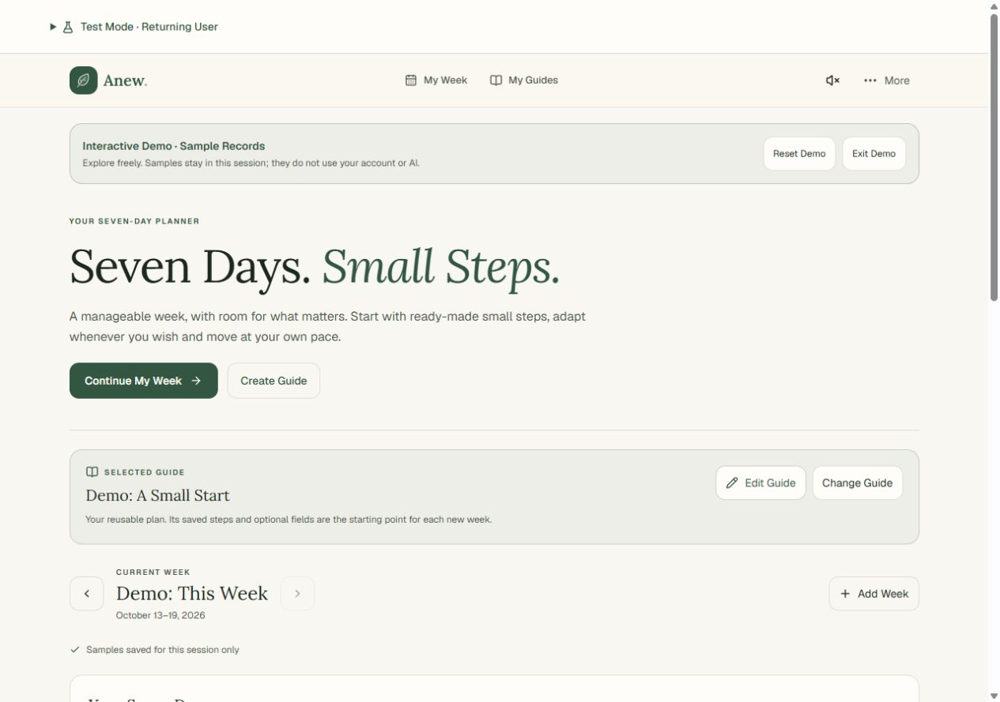
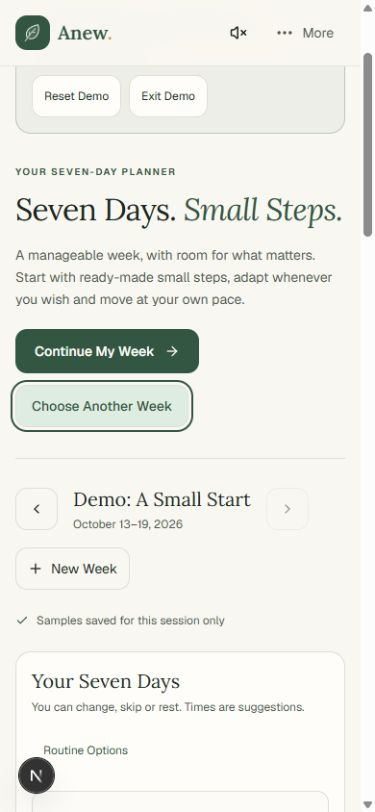
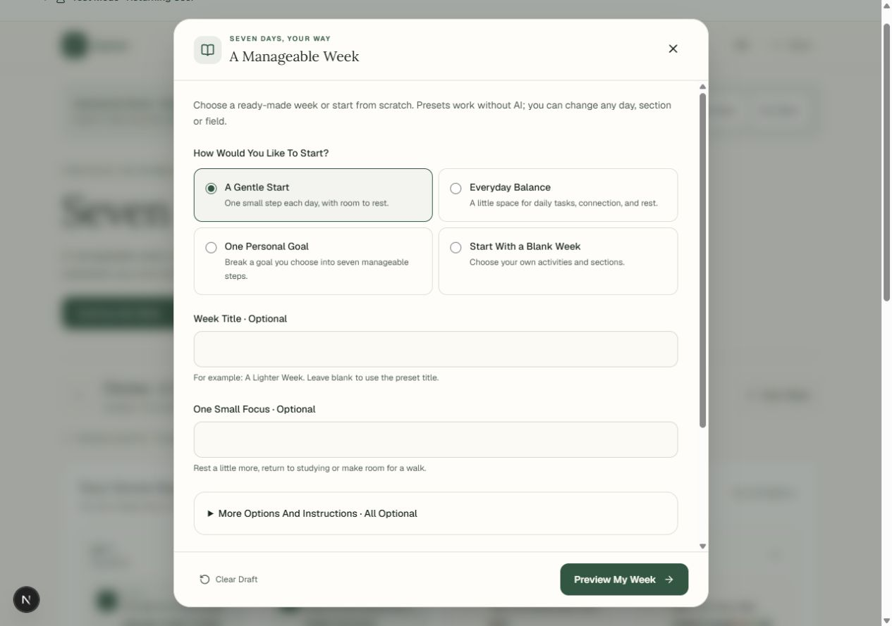

<div align="center">
  <br />
  <a href="https://github.com/danielpasquini/anew-seven-day-planner">
    
  </a>

  <h1 align="center">Anew</h1>

  <p align="center">
    <strong>Seven Days. Small Steps. Your Pace.</strong>
  </p>

  <p align="center">
    A serene, low-cognitive-load personal planner designed for mental wellness, sustainable habits, and calm focus.<br />
    Featuring bounded weekly horizons, offline-first privacy, procedural audio soundscapes, and cross-platform native support.
  </p>

  <p align="center">
    <a href="https://nextjs.org"></a>
    <a href="https://react.dev"></a>
    <a href="https://tailwindcss.com"></a>
    <a href="https://expo.dev"></a>
    <a href="https://www.typescriptlang.org"></a>
    <a href="LICENSE"></a>
  </p>

  <p align="center">
    <a href="#overview">Overview</a> •
    <a href="#why-anew">Why Anew</a> •
    <a href="#screenshots">Screenshots</a> •
    <a href="#key-features">Key Features</a> •
    <a href="#procedural-sound-engine">Sound Engine</a> •
    <a href="#tech-stack">Tech Stack</a> •
    <a href="#getting-started">Getting Started</a> •
    <a href="#testing--qa-portal">Testing & QA</a> •
    <a href="#project-structure">Project Structure</a> •
    <a href="#faq">FAQ</a> •
    <a href="#license">License</a>
  </p>

  <br />
</div>

---

## Overview

Traditional productivity apps often amplify anxiety. Endless backlogs, red overdue counters, rigid streaks, and bloated Kanban boards demand relentless attention, leading to guilt and cognitive burnout.

**Anew** is intentionally crafted as an antidote to productivity overwhelm. It replaces infinite task lists with a bounded, compassionate **7-day horizon**. Built with an editorial warm-paper aesthetic, zero-telemetry offline storage, and an in-browser procedural audio synthesizer, Anew helps you gently regain momentum—one deliberate step at a time.

```
       Rest Week           Gentle Start          Everyday Balance         Blank Slate
   [Exhaustion/Burnout]  [Rebuilding Energy]    [Balanced Rhythms]      [Custom Cadence]
            │                     │                     │                      │
            └─────────────────────┴──────────┬──────────┴──────────────────────┘
                                             ▼
                                  7-Day Bounded Horizons
                                  (Zero-Guilt Resets)
```

---

## Screenshots

<div align="center">
  <table border="0" style="border: none;">
    <tr>
      <td align="center" width="65%" valign="top">
        <strong>Desktop Planner & 7-Day Bento Dashboard</strong><br /><br />
        
      </td>
      <td align="center" width="35%" valign="top">
        <strong>Mobile & Native Interface</strong><br /><br />
        
      </td>
    </tr>
    <tr>
      <td align="center" colspan="2">
        <br />
        <strong>Mindful Onboarding & Guided Self-Assessment</strong><br /><br />
        
      </td>
    </tr>
  </table>
</div>

---

## Why Anew?

| Traditional Task Managers | The Anew Experience |
|:---|:---|
| ❌ **Infinite backlogs** inducing guilt and paralysis |  **Strict 7-day horizon** that starts fresh every cycle |
| ❌ Punitive streak counters that shame missed days |  **Zero-guilt resets** with compassionate recovery cadences |
| ❌ Heavy notifications, badge counts, and urgency banners |  **Quiet ambient atmosphere** with gentle auditory cues |
| ❌ Mandatory account creation and user data harvesting | 🛡️ **100% guest-friendly**, local-first storage with zero tracking |
| ❌ Audio bloat downloading multi-megabyte sound files | 🎧 **Procedural Web Audio synthesis** with zero network weight |
| ❌ Intrusive AI chatbots hallucinating generic productivity advice | 🧠 **Strictly opt-in, non-coercive reflection prompts** |

---

## Key Features

### 📅 Bounded 7-Day Horizon
- **Manageable Cycles**: Organize energy, habits, and tasks strictly across seven days to eliminate long-tail mental burden.
- **Thoughtful Presets**:
  - *Rest Week*: Specially tailored for burnout recovery, emotional decompression, and essential care.
  - *Gentle Start*: Soft re-entry routines with minimal friction.
  - *Everyday Balance*: Balanced cadence between work, nourishment, reflection, and movement.
  - *Routine Builder*: Scaffold new habits with gradual progression.
  - *Blank Canvas*: Clean, custom slate for self-directed weeks.

### 🛡️ Local-First & Privacy Sovereign
- **Immediate Guest Usage**: Use every core planner feature right away without signing up, entering an email, or exposing personal data.
- **Client Persistence**: Encrypted, isolated client storage across LocalStorage and IndexedDB.
- **Optional Cloud Backup**: Firebase Authentication (Google Sign-In) and Firestore synchronization available exclusively on demand for users who wish to sync across devices.

### 🎧 Procedural Generative Sound Engine
- Zero MP3 or WAV assets downloaded. All audio is synthesized directly inside the client via the **Web Audio API**:
  - **Generative Ambient Chords**: Floating modal chord progressions inspired by Brian Eno’s *Music for Airports*.
  - **Warm Brownian Noise**: Low-frequency acoustic generator (<320 Hz low-pass filter) designed for deep focus and neurodivergent calming.
  - **Organic Micro-Haptics**: Synthesized woodblock taps on navigation and gentle harmonic resonance on task completion.
  - **Battery & Context Aware**: Automatic fade-out on tab switch or system visibility loss; touch-to-unlock audio context compliance.

### 🌿 Editorial Warm Aesthetic
- **Serene Palette**: Warm parchment and sage undertones inspired by premium stationery and contemplative literature.
- **Fluid Gestures**: Drawer sheets powered by [Vaul](https://vaul.emilkowal.ski), fluid layout animations via Framer Motion, and Tailwind CSS v4 design tokens.
- **High Accessibility**: Full keyboard navigation, WCAG AA contrast compliance, reduced-motion preferences, and sound toggle safety.

### 🧠 Non-Intrusive Guidance & Reflection
- **Opt-in AI Perspective**: Powered by Google Gemini (`gemini-3.1-flash-lite`). AI reflections never judge, push deadlines, or speak without permission—they offer calm mirrors for personal clarity.
- **Optional Spiritual Passages**: Multi-translation inspirational scriptures (KJV, NIV, ARA, NVT) kept completely neutral, optional, and user-controlled.

### 📱 Universal Monorepo (Web + Native)
- Unified full-stack architecture with Next.js 16 for Web/PWA and React Native 0.86 / Expo SDK 57 for native mobile distribution.

---

## Procedural Sound Engine

Anew avoids large audio files by synthesizing acoustic environments directly in the browser:

```
                      ┌────────────────────────────────────────┐
                      │             Web Audio API              │
                      └───────────────────┬────────────────────┘
                                          │
        ┌─────────────────────────────────┼────────────────────────────────┐
        ▼                                 ▼                                ▼
┌─────────────────┐               ┌─────────────────┐              ┌─────────────────┐
│ Ambient Chords  │               │ Brownian Noise  │              │  Tactile Fx     │
│ Procedural Eno  │               │  < 320 Hz LPF   │              │ Synthetic Clicks│
│ Modal Synthesis │               │ Deep Relaxation │              │ Harmonic Bells  │
└────────┬────────┘               └────────┬────────┘              └────────┬────────┘
         │                                 │                                │
         └─────────────────────────────────┴────────────────────────────────┘
                                           │
                                           ▼
                                [Master Limiter & Fade]
                                           │
                                           ▼
                                    Speakers / Audio
```

- **Audio Footprint**: **0 KB** bandwidth.
- **CPU Overhead**: Minimal floating-point oscillator computation with automated sleep states.
- **Customization**: Independent sliders for Ambient Volume, Brownian Noise level, and UI sound effects.

---

## Tech Stack

| Domain | Technology | Highlights |
|:---|:---|:---|
| **Web Framework** | [Next.js 16](https://nextjs.org) (App Router) | React Server Components, Turbopack, Standalone output |
| **Frontend Core** | [React 19](https://react.dev) | Modern concurrent hooks, zero hydration drift |
| **Styling** | [Tailwind CSS v4](https://tailwindcss.com) | Pure CSS variables, OKLCH color spaces, no config bloat |
| **Motion & UI** | [Framer Motion](https://motion.dev) & [Vaul](https://vaul.emilkowal.ski) | Native touch drawer sheets, bento grids, fluid transitions |
| **Native Mobile** | [React Native 0.86](https://reactnative.dev) & [Expo SDK 57](https://expo.dev) | Native gestures, Reanimated 4, Expo Router |
| **Audio Engine** | Native [Web Audio API](https://developer.mozilla.org/en-US/docs/Web/API/Web_Audio_API) | Generative polyphonic oscillators, noise buffer generation |
| **Backend & Sync** | [Firebase](https://firebase.google.com) (Auth & Firestore) | Optional cloud backup, granular security rules |
| **AI Intelligence** | [Google Gemini](https://ai.google.dev) | Structured JSON reflection prompts, low latency |
| **Language** | [TypeScript 5.7](https://www.typescriptlang.org) | Strict type checking, end-to-end type safety |

---

## Getting Started

### Prerequisites

- **Node.js**: `20.x` or higher
- **npm**: `10.x` or higher (or `pnpm`)

### 1. Clone & Install

```bash
# Clone the repository
git clone https://github.com/danielpasquini/anew-seven-day-planner.git

# Navigate to project root
cd anew-seven-day-planner

# Install all workspace dependencies
npm install
```

### 2. Configure Environment

Copy the example environment template:

```bash
cp .env.example .env.local
```

| Variable | Description | Default |
|:---|:---|:---|
| `GEMINI_API_KEY` | Google Gemini API key for opt-in reflections | *(Optional)* |
| `GEMINI_MODEL` | Gemini model variant | `gemini-3.1-flash-lite` |
| `AI_ENABLED` | Master switch for AI server endpoint | `false` |
| `NEXT_PUBLIC_FIREBASE_API_KEY` | Firebase Client API key | *(Optional)* |
| `NEXT_PUBLIC_FIREBASE_PROJECT_ID` | Firebase Project identifier (`anew-58b4a`) | *(Optional)* |
| `NEXT_PUBLIC_ENABLE_GOOGLE_AUTH` | Enable Google OAuth button | `false` |
| `NEXT_PUBLIC_ENABLE_DEMO` | Expose sandboxed demo profiles | `false` |

*(Note: The app is **100% operational** without any external keys configured. It defaults gracefully to local-first guest mode.)*

### 3. Run Development Server

```bash
# Start the web development server
npm run dev
```

Open [http://localhost:3000](http://localhost:3000) in your browser.

### 4. Run Mobile App (Native Workspace)

```bash
# Launch Expo development server for iOS / Android / Web
npm run native

# Run TypeScript verification on mobile workspace
npm run native:typecheck
```

---

## Testing & QA Portal

Anew includes automated test coverage alongside an interactive developer testing suite:

```bash
# Run complete test suite (Core storage, date boundaries, AI safety)
npm test

# Run TypeScript compilation check
npm run typecheck

# Verify Gemini AI connectivity (live adapter)
npm run check:ai
```

### Interactive Test Personas

To test distinct user states without manually clearing browser caches, start the dev server and use the dedicated test switcher:

| Persona Scenario | Command / Route | Description |
|:---|:---|:---|
| 🌟 **First-Time Visit** | `npm run test:first-visit`<br />`/test?scenario=first-visit` | Opening onboarding, sound intro, 10-question guided intake |
| 🔄 **Returning User** | `npm run test:returning`<br />`/test?scenario=returning` | Direct dashboard with existing schedule and weekly history |
| 🛡️ **Guest User** | `npm run test:guest`<br />`/test?scenario=guest` | Pure local storage, full weekly editing, cloud disabled |
| 👤 **Free Account** | `npm run test:free`<br />`/test?scenario=free` | Authenticated cloud sync, standard non-AI features |
| 💎 **Premium Account** | `npm run test:premium`<br />`/test?scenario=premium` | Cloud sync enabled + Gemini AI reflections unlocked |

---

## Project Structure

```
anew-seven-day-planner/
├── app/                       # Next.js 16 App Router pages & API routes
│   ├── api/ai/                # Edge-safe Gemini AI proxy & validation
│   ├── test/                  # QA Scenario Chooser & Sandbox portal
│   ├── layout.tsx             # Root layout with warm typography & metadata
│   └── page.tsx               # Main planner application view
├── components/                # Modular React 19 UI components
│   ├── auth-screen.tsx        # Firebase auth & cloud account manager
│   ├── guide-app.tsx          # Comprehensive self-help guide dialog
│   ├── launch-experience.tsx  # Serene first-open onboarding flow
│   ├── scripture.tsx          # Multi-translation reflective scripture cards
│   ├── sound-control.tsx      # Generative audio settings modal & sliders
│   └── welcome-journey.tsx    # 10-question self-compassion questionnaire
├── docs/                      # Technical documentation & design guides
│   ├── assets/                # README screenshots and architectural diagrams
│   ├── BIBLE-SOURCES.md       # Attribution standards for public domain texts
│   ├── LANGUAGE-GUIDELINES.md # Internationalization & bilingual standards (EN/PT)
│   ├── PSYCHOLOGY-GLOSSARY.md # Behavioral health & self-compassion taxonomy
│   └── UI-DESIGN-GUARDRAILS.md# Typography, OKLCH tokens & design principles
├── lib/                       # Core business logic & state
│   ├── audio/                 # Procedural Web Audio engine
│   │   ├── GenerativeAmbientEngine.ts  # Eno-style modal chord generator
│   │   ├── SoundFxManager.ts           # Synthetic wooden taps & resonance
│   │   ├── WarmNoiseGenerator.ts       # Brownian low-pass focus sound
│   │   └── soundStore.ts               # Audio state & volume controls
│   ├── ai/                    # Gemini prompt engineering & guardrails
│   ├── sync/                  # LocalStorage & Firestore sync reconciler
│   └── store.tsx              # Reactive 7-day state store & dispatchers
├── native/                    # React Native / Expo SDK 57 mobile workspace
│   ├── src/app/               # Expo Router native screens
│   ├── src/ui.tsx             # Native mobile UI primitives & sheets
│   └── package.json           # Native workspace dependencies
└── public/                    # Static assets & brand vectors (anew-icon.svg)
```

---

## Design Philosophy

1. **Cognitive Kindness**: Information density is carefully calibrated. We avoid visual noise, jarring transitions, and high-saturation alert badges.
2. **Offline Resilience**: You own your data. The planner functions completely without Wi-Fi, preserving your focus in distraction-free settings.
3. **Respectful Autonomy**: Features such as spiritual passages and AI assistance are strictly opt-in. The planner never assumes what you need—it asks gently.
4. **Zero Audio Bloat**: Rather than streaming heavy audio loops that drain data and battery, our sound engine produces infinite procedural sound using mathematics in the browser.

---

## FAQ

<details>
  <summary><strong>Does Anew require an internet connection?</strong></summary>
  <p>No. Anew is fundamentally local-first. All core features—including the weekly rhythm planner, the procedural Web Audio synthesizer, and the 7-day presets—operate 100% offline using your browser's persistent LocalStorage and IndexedDB.</p>
</details>

<details>
  <summary><strong>Where is my personal data stored?</strong></summary>
  <p>By default, your notes, habits, and preferences never leave your device. If you choose to enable cloud synchronization via Firebase Authentication, your encrypted records sync strictly to your own user-isolated Firestore document partition.</p>
</details>

<details>
  <summary><strong>How is the ambient music created without consuming bandwidth?</strong></summary>
  <p>Anew does not stream MP3s or download WAV files. The procedural soundscape is generated mathematically in real time through the browser's native Web Audio API using modal harmonic oscillators, low-pass filtered noise buffers, and ADSR envelopes. It consumes zero network bandwidth and negligible CPU resources.</p>
</details>

<details>
  <summary><strong>Is the AI assistant required or invasive?</strong></summary>
  <p>Never. AI assistance (via Google Gemini) is strictly opt-in and disabled by default. When enabled, it acts only when explicitly prompted to offer calm, non-judgmental reflective perspectives. It never sends unsolicited nudges or grades your productivity.</p>
</details>

<details>
  <summary><strong>Can I export or transfer my planning history?</strong></summary>
  <p>Yes. Anew provides full JSON backup export and import with cryptographic schema verification, allowing you to back up, restore, or migrate your history at any time without vendor lock-in.</p>
</details>

---

## Contributing

Contributions that align with our mindful, privacy-first ethos are welcome! Please review our [`CONTRIBUTING.md`](CONTRIBUTING.md) guide for architecture details, branch naming conventions, and test verification standards.

1. Fork the Project.
2. Create your Feature Branch (`git checkout -b feature/mindful-enhancement`).
3. Commit your Changes (`git commit -m 'Add calm habit interval preset'`).
4. Push to the Branch (`git push origin feature/mindful-enhancement`).
5. Open a Pull Request.

Please ensure all tests pass (`npm test`) and code adheres to [`docs/UI-DESIGN-GUARDRAILS.md`](docs/UI-DESIGN-GUARDRAILS.md).

---

## License

Distributed under the **MIT License**. See [`LICENSE`](LICENSE) for more details.

---

<div align="center">
  <sub>Crafted with quiet intention for peaceful minds. Seven Days. Small Steps. Your Pace.</sub>
</div>
